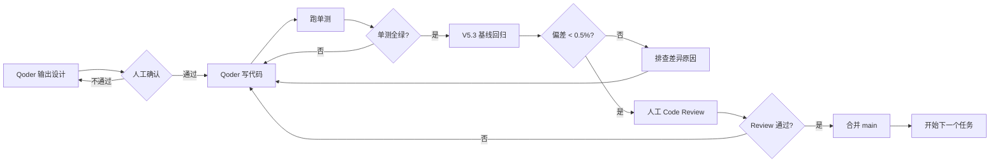

# 量化交易系统集成实施路线图（V10 升级）

> **文档定位**：基于《开源对标与 Qoder 集成蓝图 V10》深度解析，作为项目管理与 AI 协作的联合指导文件。
> **审计基准**：仓库 main 分支（最后提交 2026-08-31 / README V9.0），实测日期 2026-09-09。
> **核心原则**：**借设计模式，不搬整个框架** ｜ **保持现有风控与策略结果不变** ｜ **单机、个人、纪律自动化**

---

## 〇、执行摘要

### 系统现状一句话

你的系统在 **A 股回测真实度、防过拟合、执行归因、风控纪律、策略广度** 五个维度已超过绝大多数个人开源项目，**不要推倒重来**。真正的短板在"架构接缝"——数据源无抽象、实盘通道单一、模拟盘缺失、策略无统一协议、ML 不成流水线、工程卫生欠账。

### 升级方法论

| 原则 | 含义 |
|---|---|
| **借设计模式，不搬整个框架** | vnpy 借 Gateway 抽象、rqalpha 借撮合配置、qlib 借 ML 流水线范式、hikyuu 借策略部件化——只取接口形态，不引入任何全栈框架依赖 |
| **保持现有风控与策略结果不变** | 每次架构改造后，V5.3 基线回测收益偏差 < 0.5%，差异必须可解释 |
| **增量演进，不大爆炸重写** | 每个任务独立分支、独立验收、合并后再开下一个；52 个策略文件分批迁移 |
| **新增依赖必须可选** | 所有新依赖缺失时静默降级，不允许 import 失败导致系统崩溃 |

### 总体节奏

| 阶段 | 任务数 | 预估周期 | 核心目标 |
|---|---|---|---|
| **P0** 基础设施与架构接缝 | 4 项 | 4–6 周 | 数据层抽象 + Broker 统一 + 回测补全 + 工程卫生 |
| **P1** 策略协议与 ML 流水线 | 4 项 | 4–6 周 | 策略基类 + ML 流水线 + 参数扫描 + 仪表盘 |
| **P2** 高级编排与优化（按需） | 3 项 | 无死线 | DAG 编排 + parity 对账 + 组合优化器 |
| **总计** | 11 项 | **8–12 周**（P0+P1 关键路径） | |

---

## 一、任务依赖关系图

### 1.1 实施顺序 Flowchart

```mermaid
flowchart TD
    subgraph P0["P0：基础设施与架构接缝（4-6 周）"]
        P0_4["P0-4 工程卫生/CI<br/>🕐 第 1-2 周<br/>先清场地"]
        P0_3["P0-3 回测撮合补全<br/>🕐 第 1-2 周<br/>与 P0-4 并行"]
        P0_1["P0-1 数据层抽象<br/>🕐 第 2-4 周<br/>依赖 P0-4/P0-3"]
        P0_2["P0-2 Broker 抽象<br/>+ 模拟盘<br/>🕐 第 3-6 周<br/>依赖 P0-1/P0-3"]
    end

    subgraph P1["P1：策略协议与 ML 流水线（4-6 周）"]
        P1_1["P1-1 策略基类<br/>+ 信号协议<br/>🕐 第 5-8 周<br/>依赖 P0-2"]
        P1_3["P1-3 参数扫描<br/>+ 实验台账<br/>🕐 第 5-7 周<br/>独立，可随时插入"]
        P1_2["P1-2 ML 流水线<br/>🕐 第 7-10 周<br/>依赖 P1-1"]
        P1_4["P1-4 实盘仪表盘<br/>🕐 第 9-12 周<br/>依赖 P1-1 + P0-2"]
    end

    subgraph P2["P2：高级编排与优化（按需，无死线）"]
        P2_1["P2-1 DAG 任务编排<br/>🕐 P0/P1 稳定后"]
        P2_2["P2-2 回测/模拟 parity 对账<br/>🕐 依赖 P0-2"]
        P2_3["P2-3 成本感知组合优化器<br/>🕐 P0/P1 稳定后"]
    end

    P0_4 --> P0_1
    P0_3 --> P0_1
    P0_3 --> P0_2
    P0_1 --> P0_2
    P0_2 --> P1_1
    P0_2 --> P1_4
    P1_1 --> P1_2
    P1_1 --> P1_4
    P1_1 --> P1_3
    P0_2 --> P2_2
    P0_4 -.->|"CI 兜底全程可用"| P1_1
    P0_4 -.->|"CI 兜底全程可用"| P1_2

    style P0 fill:#1a1a2e,stroke:#e94560,stroke-width:2px
    style P1 fill:#16213e,stroke:#0f3460,stroke-width:2px
    style P2 fill:#1a1a2e,stroke:#533483,stroke-width:1px
```



### 1.2 Gantt 图（含并行可能性）

```mermaid
gantt
    title V10 升级实施甘特图
    dateFormat  YYYY-MM-DD
    axisFormat  %m/%d

    section P0 基础设施
    P0-4 工程卫生/CI           :p04, 2026-09-15, 14d
    P0-3 回测撮合补全           :p03, 2026-09-15, 14d
    P0-1 数据层抽象+多源路由     :p01, after p04, 14d
    P0-2 Broker抽象+模拟盘      :p02, after p01, 21d

    section P1 策略与ML
    P1-1 策略基类+信号协议       :p11, after p02, 18d
    P1-3 参数扫描+实验台账       :p13, after p02, 10d
    P1-2 ML流水线qlib化         :p12, after p11, 14d
    P1-4 实盘仪表盘             :p14, after p11, 14d

    section P2 高级编排（按需）
    P2-2 Parity对账             :p22, after p02, 10d
    P2-1 DAG任务编排             :p21, after p12, 14d
    P2-3 组合优化器             :p23, after p12, 14d

    section 里程碑
    M1: P0完成,回测基线验证       :milestone, after p02, 0d
    M2: P1完成,全链路贯通         :milestone, after p14, 0d
    M3: P2完成,生产就绪           :milestone, after p21, 0d
```

### 1.3 并行策略总结

| 可并行的任务组合 | 前提条件 | 节省时间 |
|---|---|---|
| P0-4 ∥ P0-3 | 无依赖，可立即同时启动 | 约 1 周 |
| P1-3 ∥ P1-1 | P0-2 完成后同时启动 | 约 1 周 |
| P2-2 ∥ P1-1 | P0-2 完成后即可启动 | 与 P1 并行 |

---

## 二、P0：基础设施与架构接缝（4–6 周）

> **阶段目标**：补齐数据抽象层、统一执行路径、补全回测撮合缺口、清理工程卫生——为后续策略协议和 ML 流水线打下地基。

---

### P0-4 工程卫生、测试与跨平台（治 G8）

**优先级说明**：最先启动。先清场地，后续每个 PR 都有 CI 兜底，改造才有安全网。

**核心目标**：
- 根目录从 43 个 .py 降至 ≤ 12 个入口文件
- pytest 转为必选开发依赖，核心包行覆盖率 ≥ 50%
- CI 双系统（Windows + Linux）全绿
- 调度去 Windows 锁定，Linux 可独立运行

**实施步骤**：

| 步骤 | 具体动作 | 产出物 |
|---|---|---|
| 1 | 根目录清理：`_tmp_*.py`、`_v101_*`、`_v102_*`、`analyze_*.py` 等一次性脚本 `git mv` 迁入 `scripts/scratch/` | 根目录 .py ≤ 12 |
| 2 | 新建 `requirements-dev.txt`（pytest, ruff, coverage），为 broker/risk/data router/position 补单测 | 核心路径覆盖率 ≥ 50% |
| 3 | 新建 `.github/workflows/ci.yml`：Windows + Linux、Python 3.10/3.11/3.12 矩阵，ruff + pytest | CI Actions 全绿 |
| 4 | 用 APScheduler 重写调度内核，`scheduler_daemon.bat` 旁补跨平台入口 `python -m trading_system.scheduler` | Linux 可 `python run.py report` |
| 5 | `requirements.txt` 与全部文本文件统一转 UTF-8 | 非中文 Windows 不乱码 |

**验收标准**：
- [ ] 根目录 .py 文件从 43 降到 ≤ 12
- [ ] CI 在 GitHub Actions 双系统全绿
- [ ] 在 Linux 上能 `python run.py report` 跑通主流程（无 schtasks 依赖）
- [ ] README 命令一览与实际文件一一对应

**分支命名**：`feat/p0-engineering-hygiene`

---

### P0-3 回测撮合补全（治 G4）

**优先级说明**：与 P0-4 并行启动。在现有 `backtest/broker.py`（360 行）基础上增量补齐，**不改变已有默认行为**。

**核心目标**：
- 成交量参与率上限（防大单一定成交的乐观偏差）
- 公司行动事件表（停牌/退市/分红/送转）
- 成交时点统一约定（信号日 vs 成交日）
- signal 模式（零摩擦快速验证）

**实施步骤**：

| 步骤 | 具体动作 | 产出物 |
|---|---|---|
| 1 | 成交量参与率：单笔不得超过当日成交量 × `max_participation_rate`（默认 25%），超出部分按配置部分成交/拒单 | `broker.py` 增量修改 |
| 2 | 新建 `data/corporate_action.py`：停牌/退市/现金分红/送转股事件表；停牌与退市日下单返回 `REJECTED` + 原因枚举；除权除息日调整持仓成本与股数 | 事件表 + 撮合适配 |
| 3 | 全局约定"信号产生于 T 日收盘后，最早 T+1 日成交"，撮合价可选 `next_open` / `next_vwap`（默认 `next_open`） | 时点约定文档化 |
| 4 | "未来函数审计"测试：任何特征/信号不得使用成交日及之后的数据 | 单测用例 |
| 5 | 增加 signal 模式：订单过风控即按信号价直接成交（零摩擦），输出必须标注"signal 模式，不代表可成交性" | 双模式对照输出 |

**验收标准**：
- [ ] 构造 4 个固定夹具单测：涨停日买入、跌停日卖出、停牌日下单、超参与率大单
- [ ] `next_open` 模式下 V5.3 基线重跑，收益数字与旧版差异可解释并记录（预期略降，成交更保守）
- [ ] signal 与撮合模式的收益差自动写入回测报告"可成交性损耗"区块
- [ ] **V5.3 基线回归偏差 < 0.5%**（默认撮合模式下）

**分支命名**：`feat/p0-backtest-completion`
**参考范式**：rqalpha 的 `sys_simulation`（matching_type / price_limit / liquidity_limit / signal）

---

### P0-1 数据层抽象 + 多源路由 + PIT 财务（治 G1）

**优先级说明**：依赖 P0-4（CI 兜底）和 P0-3（撮合基准对照）。本任务是整个系统的"数据地基"。

**核心目标**：
- 数据源抽象层 `BaseDataSource`，三源实现 + 自动故障转移
- 财务数据 PIT（披露日）语义
- 原始价 + 复权因子双存，淘汰只存前复权
- 可选 DuckDB 加速存储

**实施步骤**：

| 步骤 | 具体动作 | 产出物 |
|---|---|---|
| 1 | 新建 `data/sources/base.py`：抽象类 `BaseDataSource`，方法含 `get_daily` / `get_minute` / `get_fundamentals`（必须返回 `ann_date` 字段）/ `get_adjust_factor` / `get_trade_calendar` / `health_check` | 抽象接口定义 |
| 2 | 三个实现：`BaostockSource`（迁移现有逻辑）、`AkshareSource`（迁移现有逻辑）、`TushareSource`（新增，token 从 config_local 读取，缺 token 优雅禁用） | `sources/` 三文件 |
| 3 | 新建 `data/router.py`：`DataSourceRouter` 按 config 优先级调用，单源异常/空返回/health_check 失败自动切下一个源并记录告警；跨源偏差 > 0.5% 写数据质量表 | 路由 + 告警 |
| 4 | 日线同时落"原始价"和"复权因子"两列/两表，查询时按需计算前/后复权；写一次性迁移脚本，保留旧表备份 | 数据表改造 + 迁移脚本 |
| 5 | 财务数据查询增加 `as_of_date` 参数：只能看到该日期前已披露的财报（PIT）；单测：报告期后、披露前的 `as_of_date` 查不到该期数据 | PIT 接口 + 单测 |
| 6 | 存储保持 SQLite 默认；新增 `DuckDBStore`（duckdb 为可选依赖，缺失静默回退 SQLite） | 可选存储加速 |

**验收标准**：
- [ ] 拔掉 baostock 网络后路由自动切 akshare，日志有切源记录
- [ ] PIT 单测通过（报告期后、披露前查不到数据）
- [ ] 现有 `setup.py` 初始化与全部报告流程无改动可跑通
- [ ] **复权改造后，V5.3 回测收益与改造前偏差 < 0.5%**
- [ ] tushare token 缺失时系统正常运行，仅日志提示"TushareSource 已禁用"

**分支命名**：`feat/p0-data-source-abstract`
**参考范式**：microsoft/qlib 数据层、tushare `ann_date` 口径。**不引入 qlib 本身。**

---

### P0-2 Broker/Gateway 抽象 + PaperBroker 模拟盘（治 G2/G3）⭐ 最高价值

**优先级说明**：P0 的压轴任务，依赖 P0-1（数据层）和 P0-3（撮合规则）。这是打通"回测→模拟→实盘"三态同构的核心。

**核心目标**：
- 统一订单/成交/账户数据模型与订单状态机
- 回测/模拟/实盘三套执行路径统一为 `BaseBroker` 接口
- 模拟盘（PaperBroker）：实时行情驱动纸面撮合，独立账户表
- QMT 通道补断线重连与幂等防重复
- easytrader 兜底通道（可选）

**实施步骤**：

| 步骤 | 具体动作 | 产出物 |
|---|---|---|
| 1 | 新建 `trading_system/broker/base.py`：`Order`（code/direction/order_type/qty/price/状态/创建时间/成交时间/拒单原因）、`Fill`、`Position`、`Account` 数据类；抽象类 `BaseBroker`：`connect` / `place_order` / `cancel_order` / `query_orders` / `query_positions` / `query_account` / `on_fill(callback)`；内置订单状态机 `PENDING→SUBMITTED→PARTIAL/FILLED→CANCELED/REJECTED` | 数据模型 + 抽象接口 |
| 2 | `backtest_broker.py`：把现有 `backtest/broker.py` 撮合规则**包装**为 BaseBroker 实现（不重写算法） | 回测 Broker |
| 3 | `qmt_broker.py`：把根目录 `qmt_trader.py` 迁移为 BaseBroker 实现；xtquant 为可选依赖；补断线重连 + 下单失败重试（最多 2 次，`client_order_id` 幂等去重） | 实盘 Broker |
| 4 | `paper_broker.py`：模拟盘。用实时行情源驱动，复用 backtest_broker 撮合规则做纸面成交；独立 SQLite 表 `paper_account` / `paper_orders` / `paper_fills` / `paper_nav`；每交易日 15:30 后盯市出净值与对账单 | 模拟盘 Broker |
| 5 | `easytrader_broker.py`（可选）：easytrader 操作同花顺客户端，依赖缺失即禁用 | 兜底 Broker |
| 6 | `factory.py`：`get_broker(backend)`，backend ∈ {backtest, paper, qmt, easytrader}；`run.py` 增加 `--backend` 参数 | 工厂 + CLI 参数 |

**验收标准**：
- [ ] 同一策略 + 同一交易日，`--backend backtest` 与现有回测结果**逐笔一致**
- [ ] paper 模式连续运行 5 个交易日，订单状态流转、持仓、现金、净值勾稽关系（`现金 + 持仓市值 = 总资产`）单测全覆盖
- [ ] **实盘下单前必须经过风控层签字**（risk 层返回放行才调 `place_order`），保留现有全部风控硬约束（单票≤25%、总仓≤90%、单笔风险≤2%、日亏5%熔断等）
- [ ] qmt 未安装时 import 系统不报错
- [ ] `--backend paper` 与 `--backend backtest` 对同一历史日的订单逐笔可对照

**分支命名**：`feat/p0-broker-paper-trading`
**参考范式**：vnpy Gateway + 订单状态机、rqalpha simulation Mod。**只借接口形态，不引入 vnpy 依赖。**

---

## 三、P1：策略协议与 ML 流水线（4–6 周）

> **阶段目标**：统一 52 个策略文件的协议、建立可复现的 ML 流水线、补齐参数扫描与实验管理、落地可视化仪表盘。

---

### P1-1 策略基类与标准信号协议（治 G5）

**核心目标**：
- `BaseStrategy` 基类 + `Signal` 标准数据对象
- `@register_strategy` 装饰器与全局注册表
- 52 个策略文件分批迁移（每周 5–8 个，不搞大爆炸重写）
- 策略台账自动生成

**实施步骤**：

| 步骤 | 具体动作 | 产出物 |
|---|---|---|
| 1 | 定义 `Signal`（code, direction∈{LONG/EXIT/CLOSE}, strength∈[0,1], horizon, reason, source_strategy, tags, created_at） | `strategy/base.py` |
| 2 | 定义 `BaseStrategy`（name / version / `on_bar(context)` / `generate_signals(df, context) -> list[Signal]`） | `strategy/base.py` |
| 3 | `@register_strategy` 装饰器 + 全局注册表；融合器统一消费 Signal（按 tags/strength 加权或投票） | 注册机制 |
| 4 | 分批迁移 52 个策略文件为 BaseStrategy 子类（**每周迁 5–8 个，迁完一个跑回归**），暂无法迁移的包 adapter | 迁移 PR × 7~10 |
| 5 | 新建 `docs/strategy_registry.md`（自动生成）：每个策略的假设、参数、IC、最近表现、启用状态 | 策略台账 |

**验收标准**：
- [ ] 选股报告结果在迁移前后对同一交易日**完全一致**（快照对比）
- [ ] 新写一个示例策略只需实现一个类 + 一行注册即可被报告调用
- [ ] 策略台账包含全部已迁移策略的元信息

**分支命名**：`feat/p1-strategy-protocol`（每批一个子分支 `feat/p1-strategy-batch-N`）
**参考范式**：hikyuu 七部件资产化、rqalpha `handle_bar` / API 范式

---

### P1-2 ML 流水线轻量 qlib 化（治 G6）

**核心目标**：
- 不引入 qlib，按其范式升级 `ml/`（当前 5 文件 891 行）
- 滚动数据集切分防泄漏
- 标准因子接口 + 模型注册/版本/回滚
- ML 预测输出转为标准 Signal

**实施步骤**：

| 步骤 | 具体动作 | 产出物 |
|---|---|---|
| 1 | `dataset.py`：`RollingDataset` 按时间滚动切 train/valid/test（训练严格早于验证早于测试，标签窗口不与特征窗口重叠），切分方案版本化落库 | 防泄漏切分器 |
| 2 | `factor_lib.py`：把 `factors/` 与 Alpha158 中适用于 A 股中线的因子统一为标准因子接口（name / version / 计算函数 / 依赖字段），输出统一因子评估（IC/IR/分层收益/衰减） | 标准因子库 |
| 3 | `model_registry.py`：训练产物（模型文件 + 特征清单 + 超参 + 训练区间 + 指标 + git hash）统一注册，joblib 持久化，支持回滚到任意版本 | 模型注册表 |
| 4 | predictor 输出转换为 P1-1 的标准 Signal，打通"特征→模型→信号→组合→回测"全链路 | ML→Signal 桥接 |
| 5 | `monitor.py` 扩展：PSI、特征分布漂移、预测分数分布漂移，漂移超阈值在报告中告警（沿用"观察模式，只展示不自动降权"风格） | 漂移监控 |

**验收标准**：
- [ ] 给定随机种子两次训练产物指标**完全一致**（可复现）
- [ ] 用未来数据训练会被切分器**直接拒绝并报错**
- [ ] 模型版本切换一行配置完成，旧版本可回滚
- [ ] ML 预测输出可被融合器作为标准 Signal 消费

**分支命名**：`feat/p1-ml-pipeline`
**参考范式**：microsoft/qlib CDPE 流水线。**不引入 qlib 本身。**

---

### P1-3 参数扫描与实验台账（治 G7）

**核心目标**：
- 替代根目录散落的手工 smoke 脚本
- 网格/随机搜索 + joblib 并行
- 实验台账持久化，可追溯可对比

**实施步骤**：

| 步骤 | 具体动作 | 产出物 |
|---|---|---|
| 1 | 新建 `backtest/param_sweep.py`：网格/随机搜索，joblib 并行，向量化计算优先（numpy 批量） | 参数扫描引擎 |
| 2 | 每次实验把参数组合、指标（收益/回撤/夏普/胜率/换手）、代码版本 hash、耗时写入 `experiments` 表 | 实验台账 |
| 3 | `experiments_report()` 输出 top-N 与参数敏感性表 | 实验报告 |
| 4 | 删除对应手工脚本（`_v101_*`、`_v102_*` 等） | 根目录清理 |

**验收标准**：
- [ ] V5.3 关键参数（ATR 倍数、止盈阶梯等）100 组合扫描耗时 < 2 分钟
- [ ] 结果可按指标排序导出
- [ ] 对应手工脚本已删除

**分支命名**：`feat/p1-param-sweep`
**可独立插入**：不依赖 P1-1/P1-2，P0-2 完成后即可启动。

---

### P1-4 实盘仪表盘（治 G9）

**核心目标**：
- 从单文件 streamlit 扩展为多页应用
- 只读本地 SQLite，宕机不影响调度与交易主进程
- 邮件仍是主通知渠道，dashboard 只是增强

**实施步骤**：

| 步骤 | 具体动作 | 产出物 |
|---|---|---|
| 1 | 账户总览页：资产/仓位/当日盈亏/风控额度占用 | Page 1 |
| 2 | 持仓与成本/止损线页 | Page 2 |
| 3 | 当日委托与成交页（对接 P0-2 Broker 状态机） | Page 3 |
| 4 | 信号流页（P1-1 标准 Signal 实时列表） | Page 4 |
| 5 | 净值 vs 沪深 300 与归因页 | Page 5 |
| 6 | 预警台账页 | Page 6 |

**验收标准**：
- [ ] `streamlit run` 每页不报错
- [ ] 邮件仍是主通知渠道，dashboard 宕机不影响任何调度与交易
- [ ] 所有数据只读本地 SQLite，无写操作

**分支命名**：`feat/p1-dashboard`
**依赖**：P0-2（Broker 状态机）+ P1-1（Signal 协议）

---

## 四、P2：高级编排与优化（按需，无死线）

> **前置条件**：P0/P1 稳定后按需启动，不设硬性时间线。

---

### P2-1 DAG 任务编排（治 G10）

| 维度 | 内容 |
|---|---|
| **核心目标** | 轻量 DAG 替代 `run_all_tasks.py` + `.bat`：任务依赖声明、失败自动重试 2 次、超时熔断、钉钉/企微告警、运行血缘落库 |
| **技术方案** | APScheduler + 自写依赖表，**不引 Airflow** |
| **验收标准** | ① 替代现有 `run_all_tasks.py` 与 `.bat` 守护；② 任务失败自动重试 2 次后告警；③ 运行血缘可查询 |
| **预估周期** | 2 周 |

### P2-2 回测/模拟/实盘 parity 对账

| 维度 | 内容 |
|---|---|
| **核心目标** | 同一历史日，paper 回放与 backtest 逐笔对账，输出偏差报告；偏差来源分类统计（行情时点/撮合价/费用），持续收敛 |
| **技术方案** | NautilusTrader "research-to-live parity" 理念的 Python 平价实现 |
| **验收标准** | ① 对账报告自动输出；② 偏差来源可分类统计；③ 偏差趋势持续收敛 |
| **预估周期** | 1.5 周 |

### P2-3 成本感知组合优化器

| 维度 | 内容 |
|---|---|
| **核心目标** | 在现有 Kelly/风险平价之外，补均值-方差与风险预算求解器，目标函数含预期换手惩罚与冲击成本 |
| **技术方案** | 复用 P0-3 的冲击模型，输出对接 `recommend_engine` |
| **验收标准** | ① 优化输出对接 `recommend_engine` 无断裂；② 含冲击成本的目标函数 vs 不含的，回测对比有改善 |
| **预估周期** | 2 周 |

---

## 五、资源与时间评估

### 5.1 各阶段预估周期

| 任务 | 预估周期 | 前置依赖 | 可否并行 |
|---|---|---|---|
| P0-4 工程卫生 | 1–2 周 | 无 | ✅ 与 P0-3 并行 |
| P0-3 回测补全 | 1–2 周 | 无 | ✅ 与 P0-4 并行 |
| P0-1 数据层抽象 | 2 周 | P0-4, P0-3 | ❌ 需等前置 |
| P0-2 Broker+模拟盘 | 2–3 周 | P0-1, P0-3 | ❌ 需等前置 |
| **P0 小计** | **4–6 周**（关键路径） | | |
| P1-1 策略基类 | 2–3 周 | P0-2 | ❌ |
| P1-3 参数扫描 | 1–1.5 周 | P0-2 | ✅ 与 P1-1 并行 |
| P1-2 ML 流水线 | 2 周 | P1-1 | ❌ |
| P1-4 仪表盘 | 1.5–2 周 | P1-1, P0-2 | ✅ 与 P1-2 部分并行 |
| **P1 小计** | **4–6 周**（关键路径） | | |
| P2-1 DAG | 2 周 | P0/P1 稳定 | ✅ 按需 |
| P2-2 Parity 对账 | 1.5 周 | P0-2 | ✅ 可提前 |
| P2-3 组合优化 | 2 周 | P0/P1 稳定 | ✅ 按需 |

### 5.2 关键路径

```
P0-4/P0-3 (并行, 2周) → P0-1 (2周) → P0-2 (3周) → P1-1 (3周) → P1-2 (2周) → P1-4 (2周)
```

**关键路径总长：约 14 周（3.5 个月）**，通过并行可压缩至 **10–12 周**。

### 5.3 每任务对 Qoder 的工作量预估

每个 P0 任务约 3–5 轮 Qoder 对话（设计→实现→单测→回归→验收），每个 P1 任务约 2–4 轮。策略迁移（P1-1 步骤 4）每批约 1 轮。

---

## 六、风险与边界控制

### 6.1 实施红线（绝对不可触碰）

| 🔴 红线 | 说明 |
|---|---|
| **V5.3 基线回测收益偏差 < 0.5%** | 任何架构改造不允许悄悄改变策略结果，差异必须可解释 |
| **风控硬约束不可删除** | 单票≤25%、总仓≤90%、单笔风险≤2%、日亏5%熔断、连亏渐进暂停、放量大跌8%强平——这些是系统核心价值 |
| **实盘下单必须经风控签字** | risk 层返回放行才可调 `place_order`，无例外 |
| **每个任务必须回归验证** | 每完成一个任务，用 V5.3 基线（+47.3%/-8.0%）做一次回归对照 |

### 6.2 明确不做清单（防止架构腐化）

| ❌ 不做 | 原因 |
|---|---|
| **不整体引入 vnpy / QUANTAXIS / WonderTrader** | 它们面向多用户、多品种（期货为主）、重 GUI/消息总线/MongoDB/C++，与"单机、个人、纪律自动化、邮件驱动"的内核冲突 |
| **不引入 NautilusTrader** | Rust 工具链、A 股无现成 adapter、纳秒/Tick 级对 3 天–4 周中线波段无收益 |
| **不迁移 backtrader / zipline** | 维护停滞或停更，A 股规则要自建，你的 broker 已更强 |
| **不付费依赖 vectorbt PRO** | 参数扫描用自研向量化即可满足 |
| **FinRL / RL 不进生产链路** | 中线样本量不足、策略不可解释，与"消除人为情绪、纪律可审计"的目标相悖；可在 research 目录做实验 |
| **不把 QMT 之外的券商通道作为近期目标** | 已在 QMT 条件单工作流上，easytrader 只做兜底；通道多了维护成本指数上升 |
| **不追求 Tick / 高频** | 与系统定位（中线波段）无关，数据与算力成本不划算 |
| **不做"顺手重构"** | 只做当前任务范围，不允许搭便车式重构 |

### 6.3 风险预案

| 风险 | 概率 | 影响 | 预案 |
|---|---|---|---|
| baostock 接口突变导致数据源切换频繁 | 中 | P0-1 路由逻辑需紧急适配 | 路由层已有 akshare 兜底，加监控告警 |
| 策略迁移（P1-1）过程中选股结果漂移 | 高 | 迁移暂停 | 每批迁移后快照对比，漂移即回滚该批 |
| PaperBroker 行情源中断导致模拟盘停摆 | 中 | 模拟数据不连续 | 行情缺失时暂停撮合，日志告警，不补造数据 |
| APScheduler 替换 schtasks 后调度不稳定 | 低 | 任务漏执行 | 保留 schtasks 作为降级方案，双轨运行 2 周 |
| DuckDB 引入后与 SQLite 行为不一致 | 低 | 数据偏差 | DuckDB 为可选加速层，默认仍 SQLite |

---

## 七、Qoder 协作规范

> 以下约束建议写入 `.qoder/skills/quant-system-upgrade/SKILL.md` 或每次对话置顶。

### 7.1 全局约束（每次任务必须遵守）

| # | 约束 | 说明 |
|---|---|---|
| 1 | **先出设计再写代码** | 每个任务先输出改动文件清单与接口设计，经人工确认后再写代码 |
| 2 | **只做当前任务范围** | 不允许"顺手重构"，不在当前 PR 里夹带无关改动 |
| 3 | **新增依赖必须可选** | 所有新依赖缺失时静默降级（try/except ImportError），不允许 import 失败导致系统崩溃 |
| 4 | **不删除任何风控硬约束** | 风控是最高优先级，任何改动不得削弱风控规则 |
| 5 | **每个任务独立分支与验收** | 分支命名 `feat/p0-xxx` / `feat/p1-xxx`，合并前必须跑通验收标准 |
| 6 | **每个任务带单元测试与回归对照** | 单测覆盖新增逻辑，回归对照 V5.3 基线 |
| 7 | **参考范式只借接口形态** | 不引入 vnpy/qlib/rqalpha 等框架的依赖，只参考其设计模式 |

### 7.2 任务派发模板

每个任务按以下结构派发给 Qoder：

```markdown
## 任务：P0-X [任务名称]

### 背景
[一句话说明治哪个 Gap]

### 任务定义
[蓝图中对应的完整任务定义，整段粘贴]

### 参考范式
[参考哪个开源项目的什么设计，明确"不引入 XX 依赖"]

### 交付物
1. 改动文件清单（先输出，确认后再写代码）
2. 接口设计 / 数据表变更
3. 单元测试
4. V5.3 基线回归对照结果

### 验收标准
[蓝图中对应的验收标准清单]

### 分支
feat/p0-xxx

### 约束
- 只做本任务范围，不顺手重构
- 新增依赖可选、缺失静默降级
- 不删除任何风控硬约束
```

### 7.3 验收流程



### 7.4 回归验证基线

每次架构改造后，必须用以下基线数据做回归对照：

| 指标 | V5.3 基线值 | 允许偏差 |
|---|---|---|
| 累计收益率 | +47.3% | < 0.5% |
| 最大回撤 | -8.0% | 绝对值不恶化 |
| 夏普比率 | 基线值 | 不恶化 |
| 胜率 | 基线值 | 不恶化 |

> 偏差在 0.5% 以内且可解释（如复权计算方式变化导致的微小差异）视为通过；偏差 > 0.5% 必须排查原因并修复。

---

## 八、附录

### 附录 A：现有优势清单（别改丢了）

| 能力 | 实测位置 | 对标评价 |
|---|---|---|
| A 股回测撮合真实度 | `backtest/broker.py`（360 行） | 强于 backtrader 默认，接近 rqalpha |
| 防过拟合套件 | `walk_forward.py` + `monte_carlo.py` + `deflated_sharpe.py` | 个人项目罕见，机构级 |
| 执行分析 | `execution/` 8 文件 | 多数开源框架只做成交不做分析 |
| 归因体系 | `attribution/` 4 文件 | 接近买方研究配置 |
| 风控纪律 | 六大硬约束 | 系统核心价值 |
| A 股本土策略广度 | `strategy/` 54 文件 | 超过任何单一开源框架 |
| 工程体验细节 | 配置分层 / setup_check / 静默降级 | 开源发布意识好 |

### 附录 B：开源参考项目速查

| 项目 | 借鉴点 | 采用方式 |
|---|---|---|
| vnpy | Gateway 抽象、订单状态机 | 只借接口设计 |
| rqalpha | 撮合配置项、signal 模式、Mod Hook | 只借设计范式 |
| qlib | CDPE 流水线、因子库标准、滚动切分 | 只借范式，不引入 |
| hikyuu | 七部件资产化 | 策略基类参考 |
| easytrader | 同花顺客户端操控 | 兜底通道 |
| akshare / tushare | 数据广度 / 财务 PIT | 多源路由 |
| NautilusTrader | research-to-live parity 理念 | P2-2 对账参考 |

### 附录 C：Gap → 任务映射

| Gap | 任务 | 优先级 |
|---|---|---|
| G1 数据源无抽象层 | P0-1 | P0 |
| G2 实盘通道单一 | P0-2 | P0 |
| G3 无模拟盘 | P0-2 | P0 |
| G4 回测撮合缺口 | P0-3 | P0 |
| G5 策略无统一协议 | P1-1 | P1 |
| G6 ML 层薄 | P1-2 | P1 |
| G7 参数寻优手工 | P1-3 | P1 |
| G8 工程卫生欠账 | P0-4 | P0（最先） |
| G9 无可视化 UI | P1-4 | P1 |
| G10 任务编排硬编码 | P2-1 | P2 |

---

> **文档版本**：V1.1 | **生成日期**：2026-09-09 | **最后更新**：2026-09-21 | **基于**：《开源对标与 Qoder 集成蓝图 V10》

---

## 附录：V10 智能调仓功能实施记录（2026-09-21 完成）

以下功能已全部实施完成，详见 `docs/system_architecture.md` 第五节。

| 编号 | 功能 | 状态 | 实施文件 |
|------|------|------|--------|
| V10-01 | RegimePlaybook 三态策略手册 | ✅ 已完成 | `strategy/regime_playbook.py` |
| V10-02 | ActionPlanner 调仓建议生成器 | ✅ 已完成 | `strategy/action_planner.py` |
| V10-03 | FeedbackLoop 绩效反馈闭环 | ✅ 已完成 | `strategy/feedback_loop.py` |
| V10-04 | ActionPlanner 集成到 daily_orders.py (P0-C) | ✅ 已完成 | `daily_orders.py` L5.2节 |
| V10-05 | 熔断状态约束条件单生成 (P0-D) | ✅ 已完成 | `daily_orders.py` L5节 |
| V10-06 | Regime 状态防抖 (P0-A) | ✅ 已完成 | `strategy/market_regime.py` |
| V10-07 | 极端行情应急通道 (P1-A) | ✅ 已完成 | `strategy/market_regime.py` |
| V10-08 | 板块加速度 + ETF映射扩展 (P1-B/P1-C) | ✅ 已完成 | `strategy/sector_rotation_strategy.py` |
| V10-09 | 加仓质量门槛 + 涨跌停过滤 (P1-E/P2-B) | ✅ 已完成 | `strategy/action_planner.py` |
| V10-10 | 目标仓位置信度动态调整 (P1-F) | ✅ 已完成 | `strategy/action_planner.py` |
| V10-11 | Playbook与风控仓位限制对齐 (P1-G) | ✅ 已完成 | `strategy/regime_playbook.py` |
| V10-12 | 宽度代理精度改进 (P2-A) | ✅ 已完成 | `strategy/market_regime.py` |
| V10-13 | 换手率控制机制 (P2-C) | ✅ 已完成 | `strategy/action_planner.py` |
