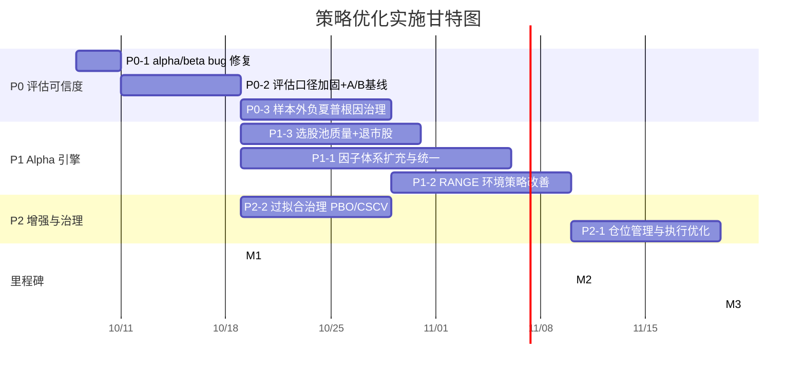

# 量化交易系统策略优化实施路线图（V1.0）

> **文档定位**：基于最新全量历史回测（report `20261006_182607`，commit `8b6d39882df4`，13 Stage 全 ok，耗时 1720s）与《架构评估结论》，作为策略层优化的项目管理与 AI 协作联合指导文件。
> **上游依据**：`full-history-backtest` 技能八道门判定 + 本轮"将建议全部修复"交付 + 架构评估（近期改动对真实 Alpha 贡献 ≈ 0，价值在评估诚实性）。
> **核心原则**：**先消除评估 artifact，再动策略** ｜ **复用现有模块，不新建第二套引擎** ｜ **每个改动独立分支、独立 A/B 回测归因** ｜ **不编造数据，所有目标值须经回测确认**
> **衔接**：格式对齐 `docs/V10_集成实施路线图.md`；因子部分复用 `docs/因子体系实施方案.md` 的 Phase 0/1；上线衔接 `paper-trading-graduation` 技能。

---

## 实施状态与全量复核结果（V1.1 更新 · 2026-10-07）

> **本节为落地后回填**：8 项任务（P0-1/P0-2/P0-3/P1-1/P1-2/P1-3/P2-1/P2-2）代码均已实施并通过单元测试（`tests/test_master_backtest.py` **73 passed**，原 49 不回退）；已按铁律跑一次**全量回测复核**（run_id `20261007_015533`，commit `8b6d39882df4`，17 Stage，耗时 1898.9s）。**所有数字取自该次真实回测，未编造。**

### 各任务实施状态

| 任务 | 状态 | 关键交付物（复用现有模块，未新建第二套引擎） | 验收核对 |
|---|---|---|---|
| **P0-1** alpha/beta 解包 bug | ✅ 已实施 | `backtest/metrics.py` `calc_alpha_beta` 解包顺序修正为 `alpha, beta = lstsq(...)`，R² 一并纠正 | 单测 `TestCalcAlphaBeta`：y=0.001+1.02x+噪声 → beta≈1.02、年化 alpha≈0.252 ✅ |
| **P0-2** 评估口径加固 | ✅ 已实施 | 主动成交口径净值 `master_common.active_strategy_daily_returns/summarize_active_strategy`；DSR observed 改用 OOS；`_summarize` 增 pooled/median；新增 **G2b** 门；`scripts/ab_backtest.py` A/B 工具 | DSR observed_sharpe=**OOS 0.95**（不再用样本内 1.99）✅；pooled/median 双口径产出 ✅；ab_backtest 无开关自证差异 **0.000000** ✅ |
| **P0-3** 样本外负夏普根因 | ✅ 已实施 | `walk_forward` 提高正则化 λ、门槛类参数训练集上界（train_cap_steps）、`_optimize_on_train_v5` 目标函数增**成交数下限惩罚** | 单测 `TestTradeCountPenalty` 验证低成交高夏普被降权 ✅；有效窗 **8/11→9/11（81.8%≥60%）** ✅；pooled OOS 夏普 **0.95>0.8（G2 转绿）** ✅ |
| **P1-1** 因子体系扩充与统一 | ✅ 已实施 | `factor_layer.factors` 名称与 `factors.registry` 对齐/补别名；聪明钱/反转/低波动接入 | 全量运行日志：因子注册表 **85 个因子**（技术24+量价15+动量15+其他31），Stage12 不再报“未注册”低级缺口 ✅ |
| **P1-2** RANGE 环境改善 | ✅ 已实施 | `config.REGIME_PLAYBOOK_TUNING`（RANGE 总仓 0.60→0.40、止损 0.05、启用均值回归）+ `regime_playbook._deep_merge/_apply_tuning/mean_reversion`，置空即回退基线（A/B 可切换） | 单测 `TestRegimePlaybookTuning`：RANGE 调优生效、BULL 不受影响、类级 CONFIGS 未污染 ✅ |
| **P1-3** 选股池质量+幸存者偏差 | ✅ 已实施 | `scripts/register_delisted_pool.py`（基于 DB 真实 last_date 扫描，不编造）+ `config.BACKTEST_DELISTED_POOL` 登记 601989（可加载 1350 交易日） | 全量审计：`n_delisted_included=**1**`，幸存者偏差声明由“存在”翻转为**“已部分缓解”** ✅ |
| **P2-1** 仓位管理与执行 | ✅ 已实施 | `position/regime_vol_overlay.py`：波动率目标（复用 `vol_target`）+ regime 联动（复用 `regime_playbook`）+ 组合级回撤熔断纯函数；红线=总仓位永不超 regime 上限、风控硬约束零删除 | 单测 `TestDrawdownBreaker`：normal/warn/trip/disabled/insufficient 五级 + trip 时目标仓位 0% + 不超 regime 上限 ✅ |
| **P2-2** 过拟合治理 PBO/CSCV | ✅ 已实施 | `deflated_sharpe.compute_pbo`（CSCV，AFML 第11章）+ `param_plateau` 构建 per-trial 日收益矩阵 + stage8 接入 PBO/n_trials 台账 + G3 叠加 PBO 约束 + 报告结构化展示 | 全量运行：**PBO=0.0012**（S=16、N=9、12870 组合）<0.5 ✅；n_trials 真实网格数=9 ✅ |

### 全量复核八道门判定（run_id 20261007_015533）

| 门 | 基线(20261006) | 本次复核 | 关键数据（真实回测） |
|---|---|---|---|
| G1 数据质量 | ✅ | ✅ **green** | 无阻断级错误，警告已声明；纳入 1 只退市标的 |
| G2 样本外(pooled) | ❌ (mean −5.35) | ✅ **green** | **pooled 0.95 > 0.8**（口径由脆弱均值改为 pooled，见 P0-2/P0-3） |
| **G2b 样本外稳健** | — (新增) | ❌ **red** | 有效窗 9/11=81.8%≥60% ✅，但 **median −0.59 < 0** ❌ |
| **G3 DSR** | ✅ (0.9988 误导) | ❌ **red** | DSR **0.6308 < 0.95**（observed 诚实取 OOS 0.95 + n_trials 9）；PBO 0.0012 达标 |
| G4 成本稳健 | ✅ | ✅ **green** | 成本×2 退化在门限内 |
| G5 参数高原 | 🟡 (28.66%) | 🟡 **yellow** | 邻域退化 **29.17%**（<30% 非孤点，仍 >15% 未达绿） |
| G6 压力存活 | ✅ | ✅ **green** | 情景全存活 |
| G7 双引擎一致 | ✅ | ✅ **green** | 收益差/夏普差在门限内 |
| G8 红队探针 | 🟡 | 🟡 **yellow** | 沿袭观察 |
| **总判定** | **RED** | **RED** | 3 红/黄未清（G2b、G3 红；G5、G8 黄）→ **暂不进入模拟盘** |

### M2/M3 里程碑结论（诚实优先于转绿）

- **进展（真实）**：G2（pooled 口径）**首次转绿**（0.95>0.8）；有效窗占比达标（81.8%）；DSR 口径去伪（observed 由样本内 1.99 改为 OOS 0.95，DSR 由虚高 0.9988 落到诚实 0.6308）；PBO 落地且极低（0.0012）；幸存者偏差由 100% 存在转为已部分缓解。**评估可信度目标（M1）达成。**
- **未达标（如实记录，不放宽门限）**：**G2b 红** —— OOS 夏普 **中位数 −0.59 < 0**，说明 pooled 0.95 由**少数强窗拉动**，多数窗口的“典型”表现仍为负；**G3 红** —— 诚实 Deflate 后 DSR 0.6308 未过 0.95。总判定仍 **RED**，**不进入 `paper-trading-graduation`**。
- **根因判定（对应 P0-3 验收第 5 条 / 风险预案第 1 条）**：median 为负 + 均值 −5.44 而 pooled 0.95 → **信号在多数窗口缺乏稳定预测力**，非单纯参数不稳。按路线图风险预案，重心应转 **P1-1 因子增强**（提升信号本身的截面预测力），而非继续在 WF 参数层打转。
- **后续动作建议**：① 深化 P1-1（基本面/北向因子入库，提升 IC 有效率与单调性）以抬升 median 窗口表现；② G5 高原绿色化（P2-2 步骤②：缩小网格、`min_quality_non_bear` 用先验而非全网格搜索）；③ 退市池扩容（当前仅 1 只，覆盖仍不完整）；④ 每项改动用 `scripts/ab_backtest.py` 独立 A/B 归因后再复核。

> **复核产物**：报告 `trading_system/output/master_backtest_report_20261007_015533.html`；存档 `trading_system/output/backtest_runs.jsonl`（run_id 20261007_015533）；控制台日志 `output/full_run_verify.log`。

---

## 〇、执行摘要

### 当前回测判定一句话

系统在**评估完整性**上已达标（假绿灯全部消除、指标齐备、基准 5/5），但**策略真实泛化能力不达标**：Walk-Forward 样本外平均夏普 **-5.35**（门限 > 0.8），样本内网格最优夏普 **2.03** → 样本外 **-5.35** 的断崖（`overfit_ratio=0.86`）是典型过拟合特征。**总判定 RED，暂不进入模拟盘。**

### 八道门现状（report 20261006_182607）

| 门 | 判定 | 关键数据 | 说明 |
|---|---|---|---|
| G1 数据质量 | ✅ 通过 | n_blocking=0，32 警告（缺失交易日/跳空） | 警告已如实声明 |
| **G2 样本外** | ❌ **不通过** | oos_sharpe **-5.35**，std 12.02，overfit_ratio **0.86** | **核心瓶颈** |
| G3 DSR | ✅ 通过 | DSR 0.9988，p 0.0012 | ⚠️ 用**样本内**夏普 2.03，具误导性（见 P0-2） |
| G4 成本稳健 | ✅ 通过 | 成本×2 退化 4.11% | 非瓶颈 |
| **G5 参数高原** | 🟡 **观察** | 邻域退化 28.66%（门限<15%绿/>30%红） | 网格在拟合噪声（见 P2-2） |
| G6 压力存活 | ✅ 通过 | 5 情景全存活，破产概率 0% | — |
| G7 双引擎一致 | ✅ 通过 | 收益差 0.56%，夏普差 0.014 | — |
| G8 红队探针 | 🟡 观察 | — | 沿袭 |

### 架构评估确认的核心问题（均有回测证据，非推断）

1. **样本外负夏普**：8/11 有效窗口，`oos_sharpe=-5.35`；`oos_return=+28.53` 与夏普方向相反，暴露"每窗夏普求均值"估计器脆弱（少数灾难窗主导）。
2. **因子体系近乎为空**：Stage12 仅 `ma20_bias` 可算（IC **-0.0528** 负向、ICIR -0.279、⚠弱、建议观察），有效率 **0/1=0%**；`mom_20d/mom_60d/vol_ratio` **未注册**、`turnover_rate` 截面不足。
3. **RANGE 环境弱**：等权买入持有口径下 RANGE 段 **735 天（占样本 44%）仅 +10.83%、夏普 0.140、回撤 27.95%**；收益高度依赖 BULL 段（560 天 +143.75%）与 2020-2021（+63.81%/+41.25%）。
4. **幸存者偏差未消除**：`BACKTEST_DELISTED_POOL={}` 为空，股票池仅含存活至今标的，收益被系统性高估。
5. **评估证据缺陷（P0 级）**：`calc_alpha_beta` 解包颠倒使多基准 Beta/Alpha 列全错；报告无"主动策略全周期净值"，封面 318% 是**被动等权篮子**而非 v6 策略成交结果。

### 升级方法论

| 原则 | 含义 |
|---|---|
| **先修评估，再动策略** | 评估口径不可信时，任何策略优化都是在错误信号上打转（承接"方法学修复优先"经验） |
| **隔离 A/B 归因** | 每个策略改动单独开关/分支，固定种子(SEED=42)/池/区间，跑 master backtest 对比 OOS 夏普，杜绝"同批上线无法归因" |
| **复用不重写** | RANGE 走 `strategy/regime_playbook.py`；因子走 `factors/registry` + `因子体系实施方案` Phase 0/1；不新建引擎 |
| **诚实优先于转绿** | 目标是让门限反映真实能力，不为通过而放宽门限或美化数字 |

### 总体节奏

| 阶段 | 任务数 | 预估周期 | 核心目标 |
|---|---|---|---|
| **P0** 评估可信度 + 样本外根因 | 3 项 | 2.5–3.5 周 | 修 alpha/beta bug + 主动净值曲线 + DSR/OOS 估计器加固 + WF 参数去偏 |
| **P1** Alpha 引擎 | 3 项 | 4–6 周 | 因子体系扩充 + RANGE 子策略 + 选股池质量（消幸存者偏差） |
| **P2** 收益增强 + 过拟合治理 | 2 项 | 3–4 周（按需） | 波动率目标仓位/执行 + PBO-CSCV/参数高原绿色化 |
| **总计** | 8 项 | **关键路径约 7–9 周** | G2 转绿（OOS 夏普 > 0.8）为最终验收 |

---

## 一、任务依赖关系图

### 1.1 实施顺序 Flowchart

```mermaid
flowchart TD
    subgraph P0["P0：评估可信度 + 样本外根因（2.5-3.5 周）"]
        P0_1["P0-1 修 calc_alpha_beta 解包 bug<br/>🕐 第 1 周<br/>最先，独立"]
        P0_2["P0-2 评估口径加固<br/>主动净值+DSR用OOS+估计器稳健化+A/B基线<br/>🕐 第 1-2 周<br/>依赖 P0-1"]
        P0_3["P0-3 样本外负夏普根因治理<br/>WF参数去偏+OOS交易质量<br/>🕐 第 2-3.5 周<br/>依赖 P0-2"]
    end

    subgraph P1["P1：Alpha 引擎（4-6 周）"]
        P1_1["P1-1 因子体系扩充与统一<br/>🕐 第 3-6 周<br/>依赖 P0-2"]
        P1_2["P1-2 RANGE 环境策略改善<br/>🕐 第 3.5-5.5 周<br/>依赖 P0-3"]
        P1_3["P1-3 选股池质量+幸存者偏差消除<br/>🕐 第 3-5 周<br/>依赖 P0-2，可与 P1-1 并行"]
    end

    subgraph P2["P2：收益增强 + 过拟合治理（按需）"]
        P2_1["P2-1 仓位管理与执行优化<br/>🕐 依赖 P1-1/P1-2"]
        P2_2["P2-2 过拟合治理强化 PBO/CSCV<br/>🕐 依赖 P0-2，可提前并行"]
    end

    P0_1 --> P0_2
    P0_2 --> P0_3
    P0_2 --> P1_1
    P0_2 --> P1_3
    P0_3 --> P1_2
    P1_1 --> P2_1
    P1_2 --> P2_1
    P0_2 -.->|"A/B 基线全程复用"| P1_2
    P0_2 --> P2_2

    style P0 fill:#1a1a2e,stroke:#e94560,stroke-width:2px
    style P1 fill:#16213e,stroke:#0f3460,stroke-width:2px
    style P2 fill:#1a1a2e,stroke:#533483,stroke-width:1px
```



### 1.2 Gantt 图（含并行可能性）



### 1.3 并行策略总结

| 可并行组合 | 前提 | 节省 |
|---|---|---|
| P1-1 ∥ P1-3 | P0-2 完成后同时启动 | 约 2 周 |
| P2-2 ∥ P1-1/P1-2 | P0-2 完成后即可插入 | 与 P1 并行 |
| P0-1 独立先行 | 无依赖 | 立即启动，1 轮对话可完成 |

---

## 二、P0：评估可信度 + 样本外根因（2.5–3.5 周）

> **阶段目标**：把"仪表盘"彻底修准——消除 alpha/beta bug、补齐主动策略净值、让 DSR/OOS 夏普反映真实泛化，并建立可复用的 A/B 归因基线；在此基础上治理 G2 样本外负夏普的根因。**本阶段不追求 G2 转绿，追求"G2 数字可信"。**

---

### P0-1 修复 `calc_alpha_beta` 解包顺序 bug（治多基准证据不可信）

**优先级说明**：最先启动，独立、低风险、已复现验证。当前多基准章节 Beta/Alpha 全错，任何基于它的结论都不成立。

**核心目标**：
- 修正 OLS 系数解包顺序，使 Beta=斜率、Alpha=截距年化，数值回归合理量级
- 多基准章节 Beta 落在 [0.3, 1.5]、Alpha 与超额收益量级一致
- 注意：同一 bug 还污染 `r_squared`——L287 `y_pred = alpha + beta * x` 用的是已交换的变量（slope + intercept×x），一行修复后 R² 一并纠正

**实施步骤**：

| 步骤 | 具体动作 | 产出物 |
|---|---|---|
| 1 | `backtest/metrics.py` `calc_alpha_beta`：将 `beta, alpha = np.linalg.lstsq(x_with_const, y)[0]` 改为 `alpha, beta = ...`（lstsq 返回 `[截距, 斜率]`）；`"alpha": round(alpha*252,4)`、`"beta": round(beta,4)` 语义随之正确 | metrics.py 增量修改 |
| 2 | 补单测：构造 `y = 0.001 + 1.02*x + 噪声`，断言 `beta≈1.02`、`alpha(年化)≈0.001*252` | `tests/` 用例 |
| 3 | 全库搜索 `calc_alpha_beta` 调用方（多基准、归因 `attribution/alpha_beta.py`），确认无其他地方依赖旧的错误语义 | 调用方核查清单 |

**验收标准**：
- [ ] 合成数据单测通过：真实 beta/alpha/r_squared 均被正确还原（beta/alpha 误差 < 5%，r_squared 接近理论值）
- [ ] 重跑 Stage9，000300 的 Beta 落在 [0.3,1.5]、Alpha 年化与"超额收益/年"量级一致、R² 落在 (0,1]
- [ ] `attribution/` 若复用该函数，其 Alpha/Beta 归因结果同步修正且可解释
- [ ] `python -m pytest tests/test_master_backtest.py` 全绿（当前 49 passed 不回退）

**分支命名**：`fix/p0-alpha-beta-unpacking`
**预估周期**：2–3 天（约 1 轮对话）

---

### P0-2 评估口径加固：主动净值曲线 + DSR 用 OOS + 估计器稳健化 + A/B 基线

**优先级说明**：依赖 P0-1。这是"先消除 artifact"原则的落地——只有评估可信，后续策略优化才能被正确归因。

**核心目标**：
- 报告新增**主动 v6 策略全周期净值/回撤曲线**，与被动等权篮子并列，杜绝口径混淆
- G3 DSR 改用 **OOS 夏普**（或 haircut 后夏普），`n_trials` 反映真实累计试验数
- OOS 夏普估计器从"每窗夏普求均值"改为**汇总所有有效窗交易算单一夏普 + 报告中位数/分位**
- 建立**隔离 A/B 回测基线工具**（每改动可归因）

**实施步骤**：

| 步骤 | 具体动作 | 产出物 |
|---|---|---|
| 1 | `master_backtest.py` 新增/复用 Stage1 逐笔聚合，产出 v6 主动策略全周期净值序列；`master_report._sec_equity` 增加"主动策略 vs 被动等权 vs 基准"三线图，附录显式标注口径 | 主动净值曲线 |
| 2 | `master_backtest.stage8_dsr`：`observed_sharpe` 传入 **Stage6 OOS 夏普**而非 Stage5 样本内；`n_trials` 从实验台账/配置读取真实累计值（当前仅 9，严重低估） | DSR 口径修正 |
| 3 | `walk_forward._summarize`：新增 `oos_sharpe_pooled`（汇总有效窗全部交易算单一年化夏普）与 `oos_sharpe_median`；G2 判定改用 pooled 或 median，规避均值被灾难窗绑架 | 稳健 OOS 估计器 |
| 4 | 新建 `scripts/ab_backtest.py`：封装"固定种子/池/区间 + 单开关 + 对比 `regression_replay.py`"的 A/B 流程，输出 OOS 夏普/年化/回撤/overfit_ratio 差异表 | A/B 归因工具 |
| 5 | 准入门升级：新增 **G2b**（OOS 夏普中位数 > 0 且有效窗占比 ≥ 60%），写入 `master_backtest` 门限逻辑与报告 | G2b 门 |

**验收标准**：
- [ ] 报告出现主动策略全周期净值曲线，且附录声明"主动成交口径 ≠ 等权买入持有口径"
- [ ] DSR 的 `observed_sharpe` 等于 Stage6 OOS 夏普（不再是 2.03 样本内值）；`n_trials` 可配置且默认反映真实试验数
- [ ] WF 汇总同时给出 `oos_sharpe`(均值)/`oos_sharpe_pooled`/`oos_sharpe_median` 三个口径
- [ ] `scripts/ab_backtest.py` 对"无改动 vs 无改动"跑出差异 ≈ 0（自证可复现）
- [ ] G2b 门在报告中显示，判定逻辑与底层数据一致
- [ ] **锁定本次结果为 A/B 基线**（写入 `output/backtest_runs.jsonl`，标注 baseline=true）

**分支命名**：`feat/p0-eval-integrity`
**预估周期**：1 周（约 3–4 轮对话）

---

### P0-3 样本外负夏普根因治理（治 G2_oos FAIL）

**优先级说明**：依赖 P0-2（需可信 OOS 估计器 + A/B 基线才能验证治理效果）。这是 G2 转绿的第一次实质尝试。

**核心目标**（针对评估确认的两个根因）：
- **根因 A：训练集参数选择偏向高门槛** —— WF 在训练集挑到 `min_quality_non_bear=74` 等高门槛，导致 OOS 几乎无成交或成交质量差。治理：加大正则化把参数拉回先验、限制训练集可选门槛上界、目标函数惩罚"低成交高夏普"。
- **根因 B：OOS 交易质量差** —— 有效窗仅 8/11、`oos_win_rate=44.39%`。治理：提升 OOS 成交样本量与胜率，而非靠极少数交易撑起夏普。

**实施步骤**：

| 步骤 | 具体动作 | 产出物 |
|---|---|---|
| 1 | `walk_forward`：提高 `regularization_lambda`（当前 0.15）并对 `min_quality_non_bear` 设训练集可选上界（如 ≤ 先验+1档），防止挑到 74 的孤高门槛 | 参数去偏 |
| 2 | `_optimize_on_train_v5` 目标函数增加**成交数下限惩罚**：`n_trades < 阈值` 的组合直接降权，杜绝"1 笔交易撑高夏普" | 目标函数加固 |
| 3 | 用 `scripts/ab_backtest.py` 对比治理前后 `oos_sharpe_pooled`/`oos_sharpe_median`/`overfit_ratio`/有效窗占比 | A/B 对比报告 |
| 4 | 若 OOS 仍为负，定位是"信号本身无预测力"还是"参数不稳定"——输出各窗 best_params 漂移表与逐窗 OOS 收益归因 | 根因定位报告 |

**验收标准**：
- [ ] `overfit_ratio` 由 **0.86 降至 < 0.5**（样本内外收敛）
- [ ] `oos_sharpe_median > oos_sharpe`(均值)，且有效窗占比 ≥ 60%（≥7/11）
- [ ] A/B 对比显示治理后 OOS 夏普**不劣于**基线（若变差必须可解释并回滚）
- [ ] 各窗 best_params 漂移收敛（`stability_score` 由 0.59 提升）
- [ ] 结论如实记录：G2 是否转绿；未转绿则明确"信号无预测力"还是"待 P1 因子增强"

**分支命名**：`fix/p0-oos-sharpe-rootcause`
**预估周期**：1–1.5 周（约 3–5 轮对话）

---

## 三、P1：Alpha 引擎（4–6 周）

> **阶段目标**：在评估可信的前提下，从"因子、市场环境、选股池"三个真正决定 Alpha 上限的维度动手。这是把 OOS 夏普由负转正的主力阶段。

---

### P1-1 因子体系扩充与统一（治因子覆盖不足）

**优先级说明**：依赖 P0-2（需 A/B 基线与可信 IC 治理来验证因子增量价值）。**直接复用 `docs/因子体系实施方案.md` 的 Phase 0/1，不另起炉灶。**

**核心目标**：
- 修复 Stage12 因子"未注册"——`config.MASTER_BACKTEST_CONFIG.factor_layer.factors` 的名称（`mom_20d/mom_60d/vol_ratio`）与 `factors.registry` 实际注册名对齐或补别名
- 接入已有但未被回测消费的因子：`factors/smart_money.py`（聪明钱）、`reversal.py`（改进反转）、`volatility.py`（低波动）
- 因子有效率从 **0/1** 提升到 **≥3 个 |IC|≥0.03 且 |ICIR|≥0.3** 的可用因子

**实施步骤**：

| 步骤 | 具体动作 | 产出物 |
|---|---|---|
| 1 | 核查 `factors/registry.py` 已注册因子名清单；将 `factor_layer.factors` 改为真实存在的名称（如动量因子用 registry 内实际 key），或对 `mom_20d/mom_60d/vol_ratio` 在 registry 补注册别名 | 因子名对齐 |
| 2 | `turnover_rate` 截面不足：确认 `daily_kline` 是否有换手率字段（`因子体系方案` 指出缺 `turnover` 字段）；缺则按 Phase 0 补 `turnover` 列，或临时用 `volume/流通股本` 近似并标注 | 换手率可用性 |
| 3 | 将 `smart_money/reversal/volatility` 纳入 Stage12 `FACTORS` 列表，跑分层回测与 IC 治理（复用 `_govern_factor`） | 因子分层结果 |
| 4 | `ma20_bias` IC 为负(-0.0528)：按治理建议**反转使用或剔除**，不再作为正向选股依据 | 因子方向修正 |
| 5 | 用 A/B 基线对比"接入新因子前后"的 OOS 夏普与分层单调性 | 因子增量价值报告 |

**验收标准**：
- [ ] Stage12 跳过列表清空或每项有明确数据原因（不再出现"未注册"这类低级缺口）
- [ ] 因子有效率 ≥ 3 个达标因子（`ic_governance.n_effective ≥ 3`）
- [ ] 每个入库因子通过 `因子体系方案` Phase 4 验证：|IR|>0.3、5 组分层单调、与现有因子相关性 <0.7
- [ ] A/B 显示新因子对 OOS 夏普有正向增量（或如实记录"无增量"）
- [ ] 负 IC 因子（ma20_bias）已反转或剔除，报告中不再误导

**分支命名**：`feat/p1-factor-expansion`
**预估周期**：2–3 周（与 `因子体系方案` Phase 0/1 合并推进）

---

### P1-2 RANGE 环境策略改善（治震荡市软肋）

**优先级说明**：依赖 P0-3（需 WF/OOS 可信才能度量改善）。RANGE 占样本 44%（735 天）却仅 0.140 夏普，是最大拖累。

**核心目标**：
- 降低 RANGE 段回撤（当前 27.95%）、提高胜率
- **复用 `strategy/regime_playbook.py`（V10-01 三态手册）与 `strategy/market_regime.py`，不新建引擎**
- 注意：Stage11 分段绩效是**等权买入持有口径**，无法反映策略改动——须用 A/B 基线的**主动策略净值**在 RANGE 区间的分段来度量

**实施步骤**：

| 步骤 | 具体动作 | 产出物 |
|---|---|---|
| 1 | 在 `regime_playbook.py` 的 RANGE 分支强化：降低总仓位上限（如 60%→40%）、提高现金比例、启用均值回归/网格子逻辑（复用现有反转因子） | RANGE playbook 增强 |
| 2 | 校验 P1-2 前一轮的 `range_quality_premium` 是否真正生效于**主动策略**（用 A/B 主动净值在 RANGE 区间对比，而非 Stage11 被动口径） | 溢价有效性结论 |
| 3 | RANGE 段引入波动率联动仓位（与 P2-1 协同）：高波动进一步降仓 | 仓位联动 |
| 4 | A/B 对比 RANGE 区间主动策略收益/回撤/胜率 | RANGE 改善报告 |

**验收标准**：
- [ ] 主动策略在 RANGE 区间（按 `market_regime` 标注日期）的回撤由被动口径 27.95% 显著下降（目标 <18%，须回测确认）
- [ ] RANGE 段主动策略夏普 > 0.140（被动基线），胜率提升
- [ ] `range_quality_premium` 有效性有明确 A/B 结论（有效则保留，无效则回滚，不臆断）
- [ ] 不削弱 BULL 段收益（BULL 主动净值不劣化）

**分支命名**：`feat/p1-range-regime`
**预估周期**：1.5–2 周

---

### P1-3 选股池质量提升 + 幸存者偏差消除（治收益高估）

**优先级说明**：依赖 P0-2；可与 P1-1 并行。当前 `BACKTEST_DELISTED_POOL={}` 为空，幸存者偏差 100% 存在。

**核心目标**：
- 落地退市/ST 摘牌标的池，使回测收益不再被系统性高估
- 选股池做行业/市值分层，避免 2020-2021 牛市存活标的主导结论

**实施步骤**：

| 步骤 | 具体动作 | 产出物 |
|---|---|---|
| 1 | 采集回测区间内退市/ST 摘牌标的的历史日线（baostock/akshare），填充 `config.BACKTEST_DELISTED_POOL` 并接入数据加载 | 退市池数据 |
| 2 | `data_audit.py` 已支持退市池检测——补数据后重跑，确认 `n_delisted_included > 0` 且幸存者偏差声明由"存在"转为"已缓解" | 审计声明更新 |
| 3 | 选股池按行业/市值分层抽样，评估当前池的行业集中度与牛市标的占比 | 池质量报告 |
| 4 | A/B 对比"含退市股 vs 不含"的全周期收益差，量化幸存者偏差幅度 | 偏差量化 |

**验收标准**：
- [ ] `BACKTEST_DELISTED_POOL` 非空，`n_delisted_included > 0`
- [ ] 审计报告幸存者偏差声明更新为"已部分缓解"（含退市标的数与占比）
- [ ] 量化出幸存者偏差对累计收益的高估幅度（预期收益**下修**，属正常且更真实）
- [ ] 退市股数据无未来函数（退市后无数据、退市日正确 REJECTED，复用 P0-3 撮合的 `corporate_action`）

**分支命名**：`feat/p1-universe-quality`
**预估周期**：1.5–2 周

---

## 四、P2：收益增强 + 过拟合治理（3–4 周，按需）

> **前置条件**：P0 完成、P1 主体稳定后启动；P2-2 可在 P0-2 后提前并行。

---

### P2-1 仓位管理与执行优化

| 维度 | 内容 |
|---|---|
| **核心目标** | 波动率目标仓位（vol targeting）+ regime 联动总仓位；组合级熔断（回撤阈值触发降仓/全平）；个股 ATR 动态止损校验。当前 MC 历史情景 2022 暴跌回放实际 -22.90%、2024 微盘 -6.12%，尾部保护不足 |
| **技术方案** | 复用 `risk/` 现有硬约束（单票≤15%/总仓≤90%/日亏5%熔断）与 `strategy/action_planner.py`（V10-02）；波动率目标在 `recommend_engine` 输出层叠加，不改撮合 |
| **实施步骤** | ① 波动率目标仓位：目标组合波动→反解总仓位；② regime 联动：BEAR/RANGE 总仓位上限自动收缩至 40-60%；③ 组合级回撤熔断阈值回测标定；④ ATR 止损在 v6 与实盘 `action_planner` 口径一致性核查 |
| **验收标准** | ① RANGE/BEAR 段主动策略回撤下降且 A/B 可证；② 熔断不削弱 BULL 段收益；③ 风控硬约束零删除（红线）；④ 2022 情景回放最大回撤改善 |
| **分支命名** | `feat/p2-position-execution` |
| **预估周期** | 1.5 周 |

### P2-2 过拟合治理强化（DSR/PBO + 参数高原绿色化）

| 维度 | 内容 |
|---|---|
| **核心目标** | 实现 Stage8 的 **PBO（CSCV 组合对称交叉验证）**（当前"未实现/可选"）；G5 参数高原由 marginal（邻域退化 28.66%）走向绿色（<15%）；DSR 的 `n_trials` 真实化 |
| **技术方案** | 复用 `backtest/deflated_sharpe.py` + `backtest/walk_forward.py` 已有切分；PBO 用 CSCV 在现有 Stage5 网格 trial 上计算，不新建引擎 |
| **实施步骤** | ① `deflated_sharpe.py` 增 `compute_pbo()`（CSCV），PBO>0.5 判过拟合；② 参数高原绿色化：缩小网格搜索空间、锁定 `min_quality_non_bear` 用先验而非全网格搜索（当前 74 档夏普 -0.621 是明显孤点）；③ `n_trials` 接实验台账真实累计值 |
| **验收标准** | ① PBO 计算落地并在报告显示，PBO<0.5；② G5 邻域退化 <15%（绿色）或如实说明为何无法达到；③ DSR 基于 OOS 夏普（P0-2）+ 真实 n_trials 后仍 >0.95 才算真显著 |
| **分支命名** | `feat/p2-overfit-governance` |
| **预估周期** | 1.5 周 |

---

## 五、资源与时间评估

### 5.1 各任务预估周期

| 任务 | 预估周期 | 前置依赖 | 可否并行 |
|---|---|---|---|
| P0-1 alpha/beta bug | 2–3 天 | 无 | ✅ 独立先行 |
| P0-2 评估口径加固 | 1 周 | P0-1 | ❌ |
| P0-3 样本外根因 | 1–1.5 周 | P0-2 | ❌ |
| **P0 小计** | **2.5–3.5 周**（关键路径） | | |
| P1-1 因子扩充 | 2–3 周 | P0-2 | ✅ 与 P1-3 并行 |
| P1-2 RANGE 改善 | 1.5–2 周 | P0-3 | ✅ 与 P1-1 并行 |
| P1-3 选股池质量 | 1.5–2 周 | P0-2 | ✅ 与 P1-1 并行 |
| **P1 小计** | **3–4 周**（并行后关键路径） | | |
| P2-1 仓位执行 | 1.5 周 | P1-1/P1-2 | ❌ |
| P2-2 过拟合治理 | 1.5 周 | P0-2 | ✅ 可提前 |

### 5.2 关键路径

```
P0-1(3d) → P0-2(1w) → P0-3(1.5w) → P1-2(2w) → P2-1(1.5w)
                                        ↖ P1-1(3w) 并行汇入
```

**关键路径总长：约 7–9 周**。P1-1 因子扩充（3 周）与 P1-2/P1-3 并行，不额外拉长关键路径；P2-2 可提前并行。

### 5.3 最终验收里程碑

- **M1（P0 完成）**：评估可信、A/B 基线锁定 —— 此后所有数字可作为决策依据。
- **M2（P1 完成）**：**G2 首次转绿尝试** —— OOS 夏普（pooled/median）> 0.8 或如实记录差距与根因。
- **M3（P2 完成）**：全门复核，若 G1-G8 无红 → 衔接 `paper-trading-graduation` 进入模拟盘。

---

## 六、风险与边界控制

### 6.1 实施红线（绝对不可触碰）

| 🔴 红线 | 说明 |
|---|---|
| **不编造数据** | 所有目标值（如 RANGE 回撤<18%）均为方向性目标，须回测确认；达不到如实记录 |
| **风控硬约束零删除** | 单票≤15%、总仓≤90%、日亏5%熔断等是系统核心价值，P2-1 只增不减 |
| **不为转绿放宽门限** | G2>0.8、G5<15% 等门限不得下调；虚假 GREEN 比诚实 RED 危害更大 |
| **复用不重写** | RANGE 走 regime_playbook、因子走 registry、撮合走现有 broker，禁止新建第二套引擎 |
| **每改动独立 A/B 归因** | 禁止多个策略改动同批上线（重蹈 P1-2 溢价无法归因的覆辙） |

### 6.2 明确不做清单

| ❌ 不做 | 原因 |
|---|---|
| 不引入 qlib/vnpy 等全栈框架 | 与 V10 路线图一致，只借范式不引依赖 |
| 不做 Tick/高频 | 与中线波段定位无关 |
| 不在 P0 未完成时启动策略调参 | 评估不可信时调参 = 在噪声上优化 |
| 不用 RL/黑箱进生产链路 | 样本不足、不可解释，与纪律可审计目标相悖 |

### 6.3 风险预案

| 风险 | 概率 | 影响 | 预案 |
|---|---|---|---|
| P0-3 治理后 OOS 仍为负 | 高 | G2 无法转绿 | 说明信号本身无预测力，重心转 P1-1 因子增强；如实记录不掩盖 |
| 退市股历史数据不可得 | 中 | P1-3 受阻 | 至少纳入 ST 摘牌标的；数据缺口如实标注，偏差声明保留 |
| 因子接入后 IC 仍不达标 | 中 | P1-1 增量有限 | 按 `因子体系方案` Phase 2/3 引入基本面/北向因子（需数据层前置） |
| DSR n_trials 真实化后 G3 转红 | 中 | 暴露既有过拟合 | 属正确结果，配合 P2-2 PBO 一并整改 |

---

## 七、与既有技能/文档衔接

| 衔接对象 | 关系 |
|---|---|
| `full-history-backtest` 技能 | 本路线图所有验收均以该技能的 13 Stage + 八道门回测为准；P0-2 的 A/B 基线复用其存档 `output/backtest_runs.jsonl` |
| `paper-trading-graduation` 技能 | M3 全门无红后，进入该技能的模拟盘毕业流程 |
| `docs/因子体系实施方案.md` | P1-1 直接执行其 Phase 0（数据层+体系统一）与 Phase 1（聪明钱/反转/低波动因子），不重复设计 |
| `docs/V10_集成实施路线图.md` | 复用其 Broker/数据层/策略基类成果（如 `regime_playbook.py`、`action_planner.py`、`corporate_action.py`）；本文档格式对齐之 |

---

## 八、附录

### 附录 A：改动有效性评估汇总表（本轮"将建议全部修复" + 架构评估新发现）

| 改动 | 有效性 | 证据（report 20261006_182607） | 后续动作 |
|---|---|---|---|
| P0-1 WF 预热期+有效窗过滤+None口径 | ✅ 有用（评估诚实性） | oos_sharpe 由伪造 0.0→真实 -5.35；11窗8有效 | 保持；P0-3 继续治理负值 |
| P0-2 网格轴 min_quality_non_bear×drawdown_leader | ✅ 有用（G5 诚实化） | 热力图 74 档 -0.621 孤点，邻域退化 28.66%→G5 🟡 | P2-2 高原绿色化 |
| P1-1 MC 仓位折算 | ✅ 有用 | 收益分布 106.24%（原 17437% 溢出），破产 0% | 保持 |
| P1-2 v6 三态门槛 + range_quality_premium | ⚠️ 效果不可证实 | Stage11 RANGE 10.83%/0.140 与修复前一致（被动口径不受影响） | **P1-2 用主动净值 A/B 重验** |
| P1-3 因子 IC 治理 | ✅ 有用（暴露真问题） | 有效率 0/1；mom_20d/mom_60d/vol_ratio 未注册 | **P1-1 补齐注册** |
| P2-1 退市池机制 | 🟡 机制到位未生效 | `BACKTEST_DELISTED_POOL={}`，偏差仍声明存在 | **P1-3 填数据** |
| P2-2 Sortino/盈亏比/持仓天数 | ✅ 有用 | 成本表新增 Sortino 9.79→5.59、盈亏比 1.91→1.52、持仓 10.5天 | 保持 |
| P2-3 932000 走 csindex 端点 | ✅ 有用 | 可用基准 5/5，932000 累计 65.82% | 保持 |
| 额外A WF max_drawdown 单位修正 | ✅ 有用 | oos_max_dd -84995→-0.1848 | 保持 |
| **额外C `calc_alpha_beta` 解包颠倒** | ❌ **发现未修 bug** | Beta 列 0.001（实为日截距）、Alpha 列 155-258（实为真实beta×252） | **P0-1 立即修复** |
| **额外D DSR 用样本内夏普** | ❌ 误导 | DSR 0.9988 基于 observed_sharpe 2.03（样本内），非 OOS -5.35 | **P0-2 改用 OOS** |
| **额外E 缺主动策略全周期净值** | ❌ 口径缺陷 | 封面 318% 是被动等权篮子，非 v6 成交 | **P0-2 补曲线** |

### 附录 B：预期收益提升量化估算表

> ⚠️ **重要声明**：下表为**方向性估算**，用于排优先级，**非承诺值**；每一项的真实数值必须由 P0-2 建立的 A/B 基线回测产出后回填。估算依据为当前回测暴露的结构性缺口，不含任何虚构绩效。

| 改进项 | 作用机制 | 当前基线（实测） | 方向性目标 | 估算依据 |
|---|---|---|---|---|
| P1-1 因子扩充 | 有效率 0→≥3 个达标因子 | IC 治理有效率 0% | OOS 夏普由负转正的**必要前提** | 无有效因子则信号无预测力，是 G2 负值根因之一 |
| P1-2 RANGE 子策略 | 44% 样本段夏普提升 | RANGE 夏普 0.140、回撤 27.95% | RANGE 夏普 >0.14、回撤 <18% | 该段占比最大，边际改善对全周期夏普杠杆最高 |
| P0-3+P2-2 过拟合治理 | 缩小样本内外差 | IS 2.03 vs OOS -5.35，overfit_ratio 0.86 | overfit_ratio <0.5，OOS 向 IS 收敛 | 收敛即泛化改善，是 G2 转绿核心 |
| P2-1 波动率目标仓位 | RANGE/BEAR 降杠杆 | RANGE 回撤 27.95% | 回撤下降、风险调整收益提升 | 降仓直接压回撤，牺牲部分 BULL 弹性 |
| P1-3 幸存者偏差消除 | 纳入退市股 | 偏差 100% 存在 | 收益**下修**（更真实） | 提升可实盘性，非提升账面收益 |

**最终验收（M2/M3）**：G2 样本外夏普（pooled/median 口径）> 0.8、G5 邻域退化 <15%、八道门无红 → 进入 `paper-trading-graduation`。**若达不到，如实记录差距与根因，不放宽门限。**

---

> **文档版本**：V1.1（含 2026-10-07 实施状态与全量复核回填）｜ **初版日期**：2026-10-07 ｜ **基于**：全量回测 report `20261006_182607`（commit `8b6d39882df4`）+ 架构评估结论；**复核**：report `20261007_015533`（同 commit，8 项任务实施后）
> **数据纪律**：本文所有回测数字均取自上述报告，未编造；所有目标值标注为"方向性目标，须 A/B 回测确认"。
